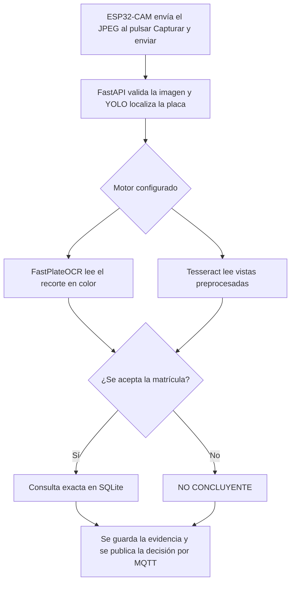

# Reconocimiento de placas · Proyecto IoT Edge

Se desarrolló este prototipo académico para reconocer matrículas de automóviles y motocicletas con una ESP32-CAM AI Thinker y un portátil.

## Flujo según el motor OCR

Se selecciona un motor al iniciar la misma API. Los comandos de este README usan **FastPlateOCR**. Para usar **Tesseract**, se inicia la API con `PLACAS_OCR_MOTOR=tesseract`.



En ambos modos, la cámara envía el JPEG a `POST /capturas`. Se intenta obtener un recorte de una sola placa con YOLO y OpenCV. Si YOLO no detecta ninguna, se devuelve `NO CONCLUYENTE`.

### FastPlateOCR · recorte en color

1. El recorte de YOLO se convierte de **BGR a RGB** y se entrega directamente a FastPlateOCR.
2. Se acepta una matrícula con formato como `ABC123` o `ABC12D` si el carácter con menor confianza alcanza `0.70`.
3. Si queda por debajo del umbral, el formato es inválido o quedan varias placas candidatas que no se pueden agrupar, se devuelve `NO CONCLUYENTE`.

### Tesseract · lectura con preprocesamiento

1. Se convierte el recorte a escala de grises, se amplía y se binariza. Si hace falta, se prueban la franja superior, una vista de los caracteres sobre fondo amarillo y una vista rectificada si se encontraron las esquinas.
2. Se acepta la lectura cuando hay una única matrícula con formato válido y confianza de al menos `0.70`. Las lecturas válidas y confiables que se contradicen quedan como `NO CONCLUYENTE`.
3. Con `PLACAS_OCR_LATERAL=1`, se puede reintentar una captura inconclusa si hay detecciones y Tesseract no produjo lecturas confiables en conflicto. Se rectifica la perspectiva y se exige que Tesseract lea la misma matrícula en al menos dos vistas y que EasyOCR confirme esa lectura.

**Salida de ambos modos.** Si se acepta la matrícula, se busca una coincidencia exacta en SQLite. Se devuelve `REGISTRADA` si existe o `NO REGISTRADA` si no está en la base. Se guarda la evidencia y se publica la decisión por MQTT para Node-RED, incluidas las capturas inconclusas. El panel consulta las imágenes a través de la API.

## Resultados de las 60 capturas

Se tomaron 60 fotos en casa con la ESP32-CAM en SXGA (1280 × 1024). Las matrículas sintéticas se mostraron en pantalla con luz fija. Se hicieron pruebas a 0,80 m, 1,15 m y 1,50 m, con ángulos de 0° y 25°. Para comparar los motores, se reenviaron los mismos JPEG a la API.

| Ensayo | Exactas | Incorrectas aceptadas | Inconclusas | Exactas a 25° |
| --- | ---: | ---: | ---: | ---: |
| Capturas originales con Tesseract | 18/60 | 4 | 38 | 0/30 |
| Repetición con Tesseract y confirmación de EasyOCR | 24/60 | 4 | 32 | 6/30 |
| Repetición con FastPlateOCR | **53/60** | **0** | **7** | **24/30** |

Se eligió FastPlateOCR para el arranque de ejemplo porque dio **53 lecturas exactas de 60 (88,3 %)** con el recorte YOLO en color. En los siete casos inconclusos se detectaron varias cajas candidatas y la API se abstuvo porque no pudo asociarlas a una sola placa. Al comparar los mismos JPEG, la mediana de procesamiento dentro de la API fue de **139,2 ms** con FastPlateOCR y **1.813,6 ms** con Tesseract y confirmación de EasyOCR. En una repetición aparte de FastPlateOCR se obtuvo una mediana de **109,2 ms**. Queda pendiente validar el desempeño con vehículos en el parqueadero.

[`comparacion_api_60.csv`](resultados/comparacion_api_60.csv) es el **CSV principal** para comparar los dos motores por caso. El índice de [`resultados/`](resultados/) indica cuándo consultar el segundo CSV y dónde están el Excel diligenciado, los registros y las fotos.

## Qué hace cada archivo Python

| Archivo | Función |
| --- | --- |
| [`preparar_modelos.py`](preparar_modelos.py) | Prepara los pesos de YOLO y FastPlateOCR antes del primer arranque. |
| [`api_placas.py`](outputs/api_placas.py) | Recibe la foto, detecta y lee la placa, consulta SQLite, guarda la evidencia y publica el resultado. La API se inicia con Uvicorn. |
| [`Repetir_60_FastPlate.py`](outputs/Repetir_60_FastPlate.py) | Vuelve a procesar las 60 fotos con FastPlateOCR y genera un CSV nuevo. Se puede ejecutar sin cámara ni servicios Docker. |
| [`Captura_guiada_placas.py`](outputs/Captura_guiada_placas.py) | Permite tomar fotos nuevas desde una ventana y guarda la decisión, el tiempo de ida y vuelta y el ID en una copia de la planilla. |
| [`Importar_resultados_placas.py`](outputs/Importar_resultados_placas.py) | Completa campos vacíos en una copia de una planilla que ya tiene IDs de captura. Cruza cada ID con su diagnóstico y recupera el tiempo total si se proporciona un archivo HAR del navegador. Es opcional. |

El recorrido de una foto se describe en [Flujo de la API](outputs/Flujo_API_placas.md). Los controles de cámara están en [`CameraWebServerPlacas/`](outputs/CameraWebServerPlacas/). El broker y Node-RED se configuran en [`compose.yaml`](compose.yaml) y el panel se importa con [`flows_placas.json`](outputs/flows_placas.json). Se incluyó una [planilla vacía](outputs/Protocolo_pruebas_placas_luz_fija.xlsx) para nuevas pruebas.

## Instalación en el portátil

Usa Python 3.11, Docker con Compose y Arduino IDE para programar la cámara. Todos los comandos parten de la raíz de este repositorio. El comando de PyTorch instala la edición CPU.

**Windows · PowerShell**

```powershell
py -3.11 -m venv .venv
$python = '.\.venv\Scripts\python.exe'
& $python -m pip install torch torchvision --index-url https://download.pytorch.org/whl/cpu
& $python -m pip install -r requirements.txt
& $python preparar_modelos.py
```

**Linux · Bash**

```bash
python3.11 -m venv .venv
. .venv/bin/activate
python -m pip install torch torchvision --index-url https://download.pytorch.org/whl/cpu
python -m pip install -r requirements.txt
python preparar_modelos.py
```

En Debian o Ubuntu, la edición de Python que uses debe incluir `venv`. Si `import cv2` indica que falta `libGL.so.1`, instala `libgl1` con tu gestor de paquetes. La herramienta de captura guiada requiere Tkinter, normalmente instalado con `python3-tk`.

`preparar_modelos.py` descarga `best.pt` a la caché de Hugging Face y el modelo `cct-s-v2-global-model` de FastPlateOCR a `work/ocr_comparacion/modelos/fastplate`. La preparación necesita Internet. La inferencia del prototipo se ejecuta en el portátil. Versiones de referencia de la repetición en Windows · Python 3.11.3, PyTorch 2.15.0 CPU, Ultralytics 8.4.203, OpenCV 5.0.0.93, FastPlateOCR 1.1.0 y ONNX Runtime 1.32.0. [Detector](https://huggingface.co/Koushim/yolov8-license-plate-detection) · [FastPlateOCR](https://ankandrew.github.io/fast-plate-ocr/latest/reference/inference/hub/)

## Repetir las 60 capturas sin cámara

**Windows**

```powershell
& $python .\outputs\Repetir_60_FastPlate.py
```

**Linux**

```bash
python outputs/Repetir_60_FastPlate.py
```

Para repetir la prueba se reenvían los JPEG originales a `POST /capturas` con el cliente local de FastAPI, se consulta la base de prueba en modo lectura y se comparan los seis caracteres con la referencia. Se simula el envío a MQTT y las evidencias se generan en una carpeta temporal. El CSV nuevo queda en `resultados/locales/`, que Git ignora.

## Arrancar el sistema con la cámara

1. Inicia los servicios con `docker compose up -d`. Si ya estás ejecutando Mosquitto o Node-RED en los puertos `18884` o `1880`, usa los servicios existentes con la misma configuración o libera esos puertos antes de iniciar Compose.
2. En [el editor de Node-RED](http://127.0.0.1:1880), abre **Manage palette → Install** e instala `@flowfuse/node-red-dashboard`. Importa `outputs/flows_placas.json` desde **Import** y pulsa **Deploy**. Abre [el panel de placas](http://127.0.0.1:1880/dashboard/placas) en el mismo portátil que ejecuta la API.
3. Abre una terminal en la raíz del repositorio y arranca la API con los comandos de tu sistema. La configuración de ejemplo usa FastPlateOCR, la base sintética y una carpeta nueva para las evidencias.

   **Windows · PowerShell**

   ```powershell
   $python = '.\.venv\Scripts\python.exe'
   $env:PLACAS_DB = Join-Path $PWD 'resultados/bloque_controlado/placas_controlado.db'
   $env:EVIDENCIAS_DIR = Join-Path $PWD 'resultados/locales/evidencias'
   $env:PLACAS_FASTPLATE_DIR = Join-Path $PWD 'work/ocr_comparacion/modelos/fastplate'
   $env:PLACAS_OCR_MOTOR = 'fastplate'
   & $python -m uvicorn api_placas:app --app-dir outputs --host 0.0.0.0 --port 8000
   ```

   **Linux · Bash**

   ```bash
   . .venv/bin/activate
   export PLACAS_DB="$PWD/resultados/bloque_controlado/placas_controlado.db"
   export EVIDENCIAS_DIR="$PWD/resultados/locales/evidencias"
   export PLACAS_FASTPLATE_DIR="$PWD/work/ocr_comparacion/modelos/fastplate"
   export PLACAS_OCR_MOTOR=fastplate
   python -m uvicorn api_placas:app --app-dir outputs --host 0.0.0.0 --port 8000
   ```

4. En `outputs/CameraWebServerPlacas`, copia `config_ejemplo.h` como `config_local.h`. Completa el nombre de tu Wi‑Fi, su contraseña y la URL de la API en esa copia. Usa la IP del portátil que alcanza la cámara, por ejemplo `http://192.168.1.20:8000/capturas`. Git ignora `config_local.h`. Abre `CameraWebServerPlacas.ino` en Arduino IDE y selecciona **AI Thinker ESP32-CAM** del paquete de placas ESP32 de Espressif. La versión de referencia del paquete es `3.3.10`.
5. Carga el sketch, abre el monitor serie a `115200` y entra a la IP que imprime la cámara. Cámara y portátil deben estar en la misma red de pruebas. Selecciona **SXGA (1280 × 1024)** para replicar el bloque y detén el stream antes de pulsar **Capturar y enviar**. La respuesta JSON debe indicar `ocr: "fastplate"`. El evento llega a `iot/final/placas/decisiones` y el panel muestra la imagen anotada y el recorte cuando estén disponibles. Las evidencias nuevas quedan en `resultados/locales/evidencias`.

Para usar Tesseract, instala el ejecutable con el idioma `eng`, establece `PLACAS_OCR_MOTOR=tesseract` y reinicia Uvicorn. Si el ejecutable queda fuera del `PATH`, configura `TESSERACT_EXE` con su ruta. La confirmación lateral requiere además `easyocr==1.7.2`, sus pesos de inglés en caché y `PLACAS_OCR_LATERAL=1`. La consola de la API indica el modo activo en las respuestas.

Para iniciar la captura guiada, usa `& $python .\outputs\Captura_guiada_placas.py` en PowerShell o `python outputs/Captura_guiada_placas.py` desde el entorno activado en Linux. Crea `resultados/locales/`, copia allí la planilla vacía, selecciónala en la ventana e indica la IP de CameraWebServer. Si elegiste una ruta de evidencias distinta de `resultados/locales/evidencias`, configura el mismo `EVIDENCIAS_DIR` en la terminal que abre la herramienta.
