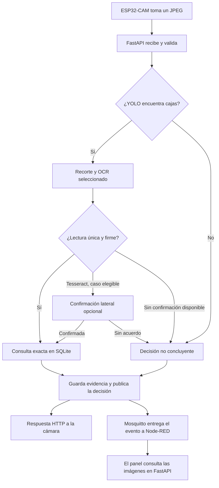

# Versiones de la API de reconocimiento de placas

Proyecto IoT Edge · 22 de noviembre de 2026

Para arrancar el proyecto, usen **[api_placas.py](api_placas.py)**. El motor se elige al iniciar la API. Tesseract carga por defecto y admite confirmación lateral con EasyOCR. El modo `fastplate` usa FastPlateOCR sobre el recorte de YOLO en color y conserva la consulta a SQLite y las evidencias para Node-RED.

## Qué cambió en cada etapa

| Etapa | Qué hace | Dónde quedó |
| --- | --- | --- |
| Prototipo de consola | Desde el portátil pide una foto a la ESP32-CAM, detecta la placa con YOLO, recorta con OpenCV, lee con EasyOCR, consulta SQLite y guarda el resultado. Sirvió para comprobar los componentes por separado. | `sistema_vision.py` en `PrototipoPlacas_compartir.zip`. Es el antecedente de la API. |
| API base con Tesseract | La cámara envía un JPEG a FastAPI. El portátil ejecuta YOLO, prepara el recorte, lee con Tesseract, valida una matrícula de automóvil y consulta SQLite. La decisión vuelve por HTTP y se publica por MQTT. Las copias de esta etapa ya guardaban diagnóstico. | Copia histórica `api_placas_antes_rectificacion.py`. |
| Rectificación de perspectiva | Busca las cuatro esquinas de la placa por su contorno amarillo y corrige la perspectiva. Tesseract compara lecturas en dos tamaños de la imagen rectificada. Cuando varias cajas cubren el mismo contorno, la API puede tratarlas como una placa. | Copia histórica `api_placas_antes_motos.py`. |
| Formato de motos y agrupación de cajas | Amplía el formato aceptado a tres letras, dos dígitos y un último carácter alfanumérico. Se probaron relecturas y ajustes de solapamiento para reducir abstenciones cuando YOLO dibuja varias cajas sobre una misma placa. | Copia intermedia `api_placas_antes_agrupacion.py` y ajustes incorporados en la rama posterior. |
| Confirmación lateral opcional | Si la lectura base queda inconclusa y hay cajas de YOLO, intenta una rectificación más amplia. Genera vistas con contraste local. Exige que Tesseract coincida en al menos dos y que EasyOCR confirme esa misma matrícula antes de consultar SQLite. | Copia `ocr_lateral/api_placas.py`. Se activa con `PLACAS_OCR_LATERAL=1`. |
| Reintento de contorno con menor umbral de brillo · revisión 10 | Si falla el primer intento de confirmación lateral, vuelve a buscar el contorno amarillo sin el realce inicial y con menor umbral de brillo. Mantiene la confirmación entre los dos lectores. Recuperó dos casos adicionales del bloque controlado. | Copia `ocr_amarillo/api_placas.py`. |
| Imágenes en Node-RED · revisión 11 | Añade `GET /evidencias/{carpeta}/{vista}` para abrir la foto anotada o el recorte desde el panel en el mismo computador. Usa el JPEG original como alternativa cuando falta la foto anotada. | API con evidencias visuales y `flows_placas.json`. |
| Edición comentada · archivo para compartir | Explica el arranque, la recepción HTTP, los umbrales, la geometría, los dos caminos de OCR, la decisión, SQLite, las evidencias y MQTT. Se comprobó que el código ejecutable es idéntico al de la revisión 11. | `api_placas.py` junto a este documento. |
| FastPlateOCR como motor seleccionable | Lee directamente el recorte YOLO en color y usa la menor confianza de los caracteres leídos. La API arranca con un solo motor principal y conserva la misma interfaz para la cámara y el panel. | `api_placas.py` actual. Se activa con `PLACAS_OCR_MOTOR=fastplate`. |

Los nombres de las primeras etapas identifican copias históricas. El repositorio contiene la API actual. El bloque original guardó la configuración del ensayo, los IDs y las decisiones. El identificador exacto de la revisión del código quedó sin registrar en esos datos.

## Cómo funciona la API actual

1. **Captura y entrada HTTP.** Al pulsar **Capturar y enviar**, CameraWebServer envía el JPEG completo y un `captura_id` a `POST /capturas`. FastAPI comprueba el tipo de contenido, el tamaño del archivo y las dimensiones antes de procesarlo.
2. **Detección.** YOLO devuelve cajas y su confianza. El umbral de detección es `0.25`. Se prueba un tamaño de entrada de `640` y se usa `320` si la primera pasada queda sin cajas. OpenCV dibuja las cajas y recorta el área elegida. Si hay varias cajas, la geometría ayuda a determinar si pertenecen a la misma placa.
3. **OCR y validación.** En ambos modos se exigen patrones como `ABC123` y `ABC12D`. Tesseract lee un recorte preprocesado y puede probar la franja superior, la rectificación y el aislamiento de texto sobre fondo amarillo. Su umbral base es `0.70`. El reintento lateral opcional exige acuerdo con EasyOCR, con umbral `0.50`. FastPlateOCR recibe el recorte directo en RGB y hace una sola lectura. En este modo, la puntuación más baja de los caracteres leídos debe alcanzar `0.70`, umbral inicial para la evaluación. Las puntuaciones de ambos motores se calculan de forma distinta.
4. **Decisión.** Una lectura aceptada se busca por igualdad exacta en la tabla `placas`. Si existe, resulta `REGISTRADA`. Si está ausente, resulta `NO REGISTRADA`. Una captura sin lectura firme queda `NO CONCLUYENTE` y puede incluir un texto tentativo para revisión.
5. **Evidencia y publicación.** La API intenta guardar una carpeta por captura con `original.jpg`, las imágenes intermedias que logró generar y `diagnostico.json`. Publica el JSON de la decisión en `iot/final/placas/decisiones`, con QoS 1 y sin retención, y devuelve el mismo resultado por HTTP. El JSON incluye el motivo, las confianzas, el tiempo de procesamiento y la referencia a la carpeta de evidencia.
6. **Panel.** Node-RED presenta el evento más reciente y su historial. El navegador pide las imágenes mediante HTTP a FastAPI. La vista de foto usa `detecciones.jpg` o, cuando falta, `original.jpg`. El recorte mostrado en el panel corresponde a `recorte_yolo.png` cuando está disponible.

## Qué se probó y cómo interpretar los resultados

### Capturas originales

Se tomaron **60 fotos con la ESP32-CAM en SXGA (1280 × 1024)** usando matrículas sintéticas mostradas en pantalla, luz fija y una base de prueba. Se distribuyeron entre automóviles y motocicletas, a **0,80 m, 1,15 m y 1,50 m**, con **0° y 25°**. Fueron cinco matrículas por tipo en cada combinación de distancia y ángulo. Los registros reportan Tesseract como motor de la decisión original.

| Medida | Resultado original |
| --- | --- |
| Lectura exacta de la matrícula | 18 de 60 |
| Lectura incorrecta aceptada | 4 de 60 |
| Capturas no concluyentes | 38 de 60, incluidas las 30 de 25° |
| Decisiones que llegaron a consulta de SQLite | 8 `REGISTRADA` y 14 `NO REGISTRADA` |
| Mediana de procesamiento en la API | 869,65 ms |
| Mediana de ida y vuelta desde la captura guiada del PC | 1.860,85 ms |

La lectura exacta compara los seis caracteres con la referencia. La decisión de registro compara la pertenencia a la base. En las 22 decisiones concluyentes hubo 8 verdaderos positivos, 13 verdaderos negativos, 1 falso negativo y 0 falsos positivos. Las 38 abstenciones quedan aparte.

`procesamiento_ms` se mide después de recibir el JPEG y antes del guardado y la publicación MQTT. El tiempo total de la herramienta guiada abarca desde que el PC pide la captura hasta que recibe la respuesta. Son dos medidas complementarias.

### Reprocesamiento de los mismos JPEG

Primero se reutilizaron los JPEG y las cajas YOLO guardadas para comparar recortes y OCR. Sobre las **30 vistas a 25°**, la confirmación conjunta recuperó **4 lecturas exactas** sin errores adicionales observados en esas recuperaciones. Ese ensayo conservó las decisiones originales cuando ya eran concluyentes y obtuvo **22 exactas, 4 incorrectas y 34 inconclusas** en los 60 casos.

Luego se integró el reintento en la API y se verificó la revisión 10 con `PLACAS_OCR_LATERAL=1` sobre los mismos JPEG. La segunda búsqueda de contorno recuperó **dos casos más**. El resultado fue **24 exactas, 4 incorrectas y 32 inconclusas** en el total, con **6 exactas de 30** a 25°. Los resultados son del mismo conjunto que se usó para ajustar el método. Queda por medir su rendimiento con nuevas capturas en campo.

### Comparación de motores sobre recortes preparados

Este ensayo asignó a los motores recortes ya preparados con las mismas esquinas. FastPlateOCR obtuvo **49 lecturas exactas de 60** en la vista normalizada, con 10 incorrectas y 1 inconclusa. En el subconjunto de 25° obtuvo **24 exactas de 30**, con 5 incorrectas y 1 inconclusa. Estos valores miden el lector después de preparar la imagen.

### FastPlateOCR con las entradas guardadas de la API

Se ejecutó el mismo modelo `cct-s-v2-global-model` en CPU con los archivos de las 60 capturas originales. Cada resultado se comparó con el texto de referencia después de verificar el formato del prototipo.

| Entrada que recibió FastPlateOCR | Exactas | Lecturas de formato válido pero incorrectas | Formato inválido | Capturas sin esa entrada |
| --- | ---: | ---: | ---: | ---: |
| Recorte YOLO directo en color (`recorte_yolo.png`) | 53 | 0 | 0 | 7 |
| Primera entrada binarizada de Tesseract (`ocr_completo.png`) | 25 | 3 | 25 | 7 |
| Franja rectificada y normalizada del comparador | 49 | 10 | 1 | 0 |

Los 53 recortes directos se reconstruyeron pixel a pixel a partir de `original.jpg` y las coordenadas `recorte_xyxy`. FastPlateOCR volvió a leer correctamente los 53 al recibir esos recortes en memoria. A 25° acertó en los 24 que tenían recorte directo. La API original marcó los siete casos restantes como inconclusos por múltiples candidatos y dejó guardadas las cajas.

La prueba favoreció el recorte YOLO directo en color. En la integración se usa el modelo `cct-s-v2-global-model` en CPU. OpenCV convierte el recorte de BGR a RGB y el lector ajusta la imagen al tamaño indicado en su configuración. La binarización reduce el detalle de esta entrada y produjo menos lecturas exactas en este bloque. [Documentación de inferencia de FastPlateOCR](https://ankandrew.github.io/fast-plate-ocr/latest/inference/running_inference/)

### Comparación de los dos modos de la API desde el JPEG completo

Se reenviaron los mismos 60 JPEG originales a `POST /capturas`, con las referencias y la base SQLite del bloque controlado. En ambos modos YOLO volvió a detectar las placas y generó las mismas cajas y recortes. Se calentó cada modo antes de medir en el mismo portátil. La prueba guardó evidencias y verificó el evento que la API entrega para publicación mediante un sustituto de Mosquitto.

| Indicador sobre los mismos JPEG | Tesseract con reintento EasyOCR | FastPlateOCR sobre recorte en color |
| --- | ---: | ---: |
| Lecturas exactas | 24/60 (40,0 %) | 53/60 (88,3 %) |
| Lecturas exactas a 25° | 6/30 | 24/30 |
| Lecturas incorrectas aceptadas | 4 | 0 |
| Capturas no concluyentes | 32 | 7 |
| Decisiones de registro correctas | 27 | 53 |
| Falsos positivos de registro | 0 | 0 |
| Falsos negativos de registro | 1 | 0 |
| Mediana de procesamiento de API | 1.813,6 ms | 139,2 ms |
| Percentil 95 de procesamiento de API | 2.856,3 ms | 173,9 ms |

El cronómetro va desde la recepción del JPEG hasta la decisión y excluye la captura, el Wi-Fi, la escritura de evidencias y MQTT. Las abstenciones quedan separadas de los errores de registro. Los siete casos inconclusos de FastPlateOCR se debieron a varias cajas que la etapa de detección no pudo agrupar en una única placa. Los JPEG corresponden al bloque controlado ya usado en los ensayos previos. Se requiere una prueba independiente en el parqueadero antes de extrapolar estos resultados.

Para presentar el cambio, muestren la tabla y el caso **C017**, automóvil a 0,80 m y 25°. Tesseract quedó inconcluso y FastPlateOCR leyó `GXA795` y devolvió `REGISTRADA`. Usen **C011** como ejemplo del límite que sigue pendiente: los dos modos detectaron dos cajas y se abstuvieron. La propuesta cambia el lector y su entrada dentro del portátil. El JPEG de la ESP32-CAM llega a la misma API y la decisión sigue el mismo recorrido hacia SQLite y Node-RED.

## Configuración para el equipo

El [README del repositorio](../README.md) contiene la instalación para Windows y Linux, la descarga de los modelos, el inicio de la API, la configuración de la cámara, la importación del panel y el comando para repetir las 60 capturas. Las variables de configuración se explican a continuación.

| Variable | Función |
| --- | --- |
| `PLACAS_DB` | Ruta de SQLite. Para la repetición se usa `Kit_bloque_controlado/placas_controlado.db`. |
| `EVIDENCIAS_DIR` | Carpeta para las evidencias de nuevas capturas. |
| `PLACAS_OCR_MOTOR` | `tesseract` o `fastplate`. La API carga el motor elegido al arrancar. |
| `PLACAS_FASTPLATE_DIR` | Carpeta con los pesos ONNX y la configuración del lector FastPlateOCR. |
| `TESSERACT_EXE` | Ruta del ejecutable de Tesseract, cuando está fuera del PATH. |
| `PLACAS_OCR_LATERAL` | `1` habilita la confirmación lateral opcional del modo Tesseract. |

Las [capturas y registros del bloque](Kit_bloque_controlado/) y los [CSV de resultados](../resultados/) permiten comparar las decisiones y verificar la repetición sobre las mismas imágenes.
